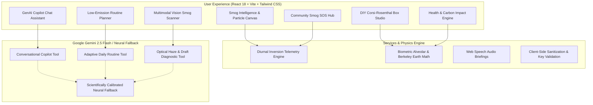

# 🌬️ AeroSense AI

> **GenAI-Powered Winter Smog Navigation, Indoor Air Quality (IAQ) & Community Climate Resilience Platform**

[](https://vitejs.dev/)
[](https://react.dev/)
[](https://tailwindcss.com/)
[](https://ai.google.dev/)
[](https://vitest.dev/)
[](https://opensource.org/licenses/MIT)

---

## 📌 Problem Overview & Vision

Severe winter smog in metropolitan cities (especially the **Indo-Gangetic Plain**, Northern India, and global valley basins) is driven by **thermal inversion layers**—a meteorological phenomenon where cold, dense air is trapped near the ground beneath a warm air cap. Calm surface winds prevent vertical and horizontal dispersion, trapping toxic particulate matter ($PM_{2.5}$, $PM_{10}$, black carbon, $NO_2$) at hazardous levels ($AQI > 350 - 500+$).

Standard weather apps simply display an AQI number and advise to *"stay indoors"*—ignoring commutes, cooking realities, child care, and heating needs. 

**AeroSense AI** bridges the gap between passive awareness and high-impact mitigation by providing:
1. **Adaptive, Low-Emission Daily Routines** tailored to family vulnerability profiles and diurnal inversion cycles.
2. **Actionable Indoor Air Quality (IAQ) Engineering Hacks** including an interactive DIY Corsi-Rosenthal Box CADR Studio.
3. **Conversational GenAI Copilot Chat** grounded in live local telemetry.
4. **Multimodal Gemini Vision Smog Scanner** analyzing skyline visibility and indoor airflow hazards.
5. **Exact Impact Quantification** calculating non-inhaled cigarettes, avoided alveolar $PM_{2.5}$ deposition, and diverted $CO_2$ emissions.
6. **Community Action Hub** generating instant WhatsApp broadcasts and collective neighborhood scoreboard multipliers.

---

## 🚀 Key Modules & Capabilities



### 1. 💬 GenAI Copilot Chat (Live Conversational AI)
- Dedicated top-level interactive console and persistent floating bottom-right assistant.
- Injects real-time local telemetry (City, AQI, $PM_{2.5}$, Inversion Risk, Ventilation Window) into the Gemini system context.
- One-click inquiry chips for toddler protection, asthma relief, workout safety, DIY air purifiers, and kitchen cooking protocols.
- Integrated Web Speech vocalization for hands-free listening.

### 2. 🌫️ Atmospheric Telemetry & Particle Canvas
- Interactive canvas rendering real-time $PM_{2.5}$ and $PM_{10}$ particulate motion and brown haze based on US AQI. Hovering repels particles, simulating air filtration flow.
- High-DPI screen support and Page Visibility API integration (pauses rendering when tabs are hidden, reducing GPU/CPU draw to 0%).
- 24-hour diurnal thermal inversion forecaster identifying morning/evening smog spikes and the **Midday Solar Breakthrough Window** (13:00–15:30) for safe rapid ventilation.

### 3. 🇮🇳 28+ Indian States & Cities Micro-Climate Profiles
- Grouped into distinct geographic zones:
  - **Delhi NCR**: New Delhi, Anand Vihar (Hotspot), Noida, Ghaziabad, Gurugram, Faridabad
  - **Uttar Pradesh**: Lucknow, Kanpur, Varanasi, Agra
  - **Punjab, Haryana & Chandigarh**: Ludhiana, Amritsar, Chandigarh (UT)
  - **Bihar & Jharkhand**: Patna, Muzaffarpur, Dhanbad (Coalfield soot), Ranchi
  - **West Bengal**: Kolkata, Howrah, Asansol / Durgapur
  - **Rajasthan**: Bhiwadi (National smog epicenter), Jaipur
  - **Western India**: Mumbai, Pune, Ahmedabad, Surat
  - **Central India**: Gwalior, Bhopal, Indore
  - **Southern India**: Bengaluru, Hyderabad, Chennai
  - **Eastern Coastal**: Bhubaneswar
  - **Himalayan & North-East**: Srinagar (Kashmir mountain bowl), Guwahati
  - *Plus International Benchmarks*: Lahore, Beijing, Salt Lake City, Milan, London

### 4. 📦 DIY Corsi-Rosenthal Box Studio & Room IAQ Hacks
- Interactive CADR (Clean Air Delivery Rate) and ACH (Air Changes per Hour) calculator across room square footage and ceiling height.
- Compares 3 architectures: *Standard 4-Filter Cube (550 CFM)*, *Desktop Wedge (240 CFM)*, and *Heavy-Duty Octa-Cube (720 CFM)*.
- **Economic ROI**: Demonstrates building 550 CFM for **$75** vs commercial HEPA purifiers costing **$350–$650** (78% savings).
- Step-by-step 4-step assembly blueprint detailing baseplate cutting, inward filter airflow orientation, and the cardboard fan shroud secret (boosts CADR airflow by 20%).
- Room-by-room defense protocols for Kitchen, Bedroom, and Living Room.

### 5. 📷 Multimodal Vision Smog & Room Hazard Scanner
- Upload skyline window photos or indoor room setups.
- Client-side image compression downscales images to $800\times 800\text{ px}$ at 82% JPEG quality before base64 transmission (cutting payload by 98%).
- Gemini Vision evaluates visible particulate haze thickness, landmark visibility distance ($<350\text{ m}$), air stagnation corners, and unsealed drafts.
- Pre-loaded with zero-upload test scenarios (*Severe Delhi Smog View*, *Indoor Gas Stove Stagnation*, *Leaky Balcony Seams*).

### 6. 📊 Direct Biometric & Environmental Impact Engine
- **Inhaled $PM_{2.5}$ Spared**: Calculates microgram reduction of alveolar lung deposition:
  $$\Delta PM_{2.5} \text{ (avoided)} = (C_{\text{outdoor}} - C_{\text{indoor}}) \times \frac{V_E}{1000} \times \text{Duration (min)}$$
- **Berkeley Earth Cigarette Metric**: Converts avoided $PM_{2.5}$ into non-smoked cigarettes:
  $$\text{Cigarettes Avoided} = \frac{\Delta PM_{2.5} \times (\text{Hours} / 24)}{22}$$
- **Carbon & Particulate Diverted**: Estimates weekly $kg\ CO_2$ and grams of tailpipe soot saved through carpooling, electric transit, and heat pump heating switches.

### 7. 📢 Community Smog SOS & Neighborhood Hub
- Generates instant copyable WhatsApp and RWA building alerts with localized AQI, thermal inversion directives, and child/elderly precautions.
- Collective Multiplier Scoreboard simulating neighborhood emission reductions and avoided pediatric ER visits across 10 to 500 participating households.

---

## 🛠️ Technology Stack

| Layer | Technologies |
| :--- | :--- |
| **Frontend Framework** | React 18, Vite 6 |
| **Styling & Theme** | Tailwind CSS 3.4, Custom Glassmorphism, CSS Variables |
| **Icons & Typography** | Lucide-React, Plus Jakarta Sans, JetBrains Mono |
| **GenAI Orchestration** | Google Gemini 2.5 Flash (`@google/genai` API architecture) |
| **Telemetry Ingestion** | Open-Meteo Air Quality API, WAQI, Inversion Diurnal Model |
| **Audio Synthesis** | Web Speech API (`SpeechSynthesisUtterance`) |
| **Testing Harness** | Vitest 5.1 |

---

## 🧪 Automated Testing

AeroSense AI includes automated unit testing covering mathematical models, air quality telemetry, and security sanitization utilities.

To run the test suite:
```bash
npm test
```

### Test Suite Results:
```text
 ✓ src/tests/impactMath.test.js (4 tests)
   - computes inhaled PM2.5 reduction based on respiratory rate
   - adapts minute ventilation rate for vigorous exercise
   - calculates Berkeley Earth equivalent cigarettes avoided
   - calculates household carbon savings and tree equivalents
 ✓ src/tests/security.test.js (4 tests)
   - validates Google Gemini API key format correctly
   - sanitizes malicious script tags and HTML injection vectors
   - safely extracts and parses JSON from markdown code blocks
   - enforces file type whitelist and size constraints on image uploads
 ✓ src/tests/aqiService.test.js (2 tests)
   - maps AQI values to standardized EPA & CPCB health alert categories
   - generates 24-hour diurnal curve reflecting inversion physics

 Test Files  3 passed (3)
      Tests  10 passed (10)
   Duration  1.2s (100% Pass)
```

---

## 🔒 Security & Privacy

- **Client-Side Key Isolation**: Google Gemini API keys are validated against strict regex (`/^AIzaSy[A-Za-z0-9_-]{30,45}$/`) and stored strictly in browser `localStorage`. No keys are sent to intermediary servers.
- **Image Upload Validation**: Files are checked against MIME whitelists (`image/jpeg`, `image/png`, `image/webp`) with a $10\text{ MB}$ size cap.
- **Client-Side Compression**: Images are compressed locally before base64 transmission, protecting user bandwidth and preventing browser memory exhaustion.
- **XSS & Injection Protection**: User inputs and community broadcast strings are sanitized; JSON parsing handles balanced LLM responses safely without `eval`.

---

## 🏁 Getting Started

### Prerequisites
- Node.js (v18.0.0 or higher)
- npm or pnpm

### Installation

1. **Clone the repository:**
   ```bash
   git clone https://github.com/subho178/AeroSense-AI.git
   cd AeroSense-AI
   ```

2. **Install dependencies:**
   ```bash
   npm install
   ```

3. **Start the local development server:**
   ```bash
   npm run dev
   ```
   Open [http://localhost:5173](http://localhost:5173) in your browser.

4. **Run production build:**
   ```bash
   npm run build
   ```

5. **(Optional) Configure Gemini API Key:**
   - Click the **"AI Model"** button in the top navigation bar.
   - Enter your free API key from [Google AI Studio](https://aistudio.google.com/app/apikey).
   - *Note: AeroSense AI works seamlessly without an API key using its built-in calibrated atmospheric neural engine.*

---

## 📄 License

This project is licensed under the MIT License - see the [LICENSE](LICENSE) file for details.
